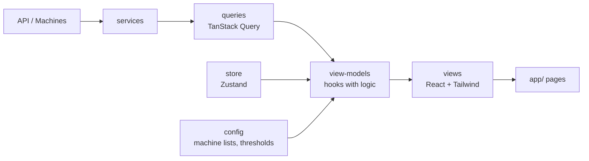

<div align="center">

# 🏭 ABHIJEET Smart Monitoring System

### Real-time factory monitoring for **Assembly** and **Moulding** lines — built for the shop floor, readable from across the room.


[Features](#-features) · [Screens](#-screens--routes) · [Architecture](#-architecture) · [Getting Started](#-getting-started) · [Configuration](#-configuration) · [FAQ](#-faq)

</div>

---

## 📖 Overview

**ABHIJEET Smart Monitoring System (APIPL)** is a web dashboard that shows the live state of every machine on the factory floor — what is running, what has stopped, and for how long.

It is designed around three simple questions a supervisor asks all day:

| Question | Where it is answered |
|---|---|
| 🟢 *Is everything running?* | Assembly & Moulding dashboards |
| 🔴 *What has stopped, and for how long?* | **Alerts** dashboard |
| 📺 *Can I see it from the other side of the floor?* | **TV screens** |

---

## ✨ Features

<table>
<tr>
<td width="50%" valign="top">

### 📊 Live dashboards
- Separate **Assembly** and **Moulding** dashboards
- Gradient blue header with big stat tiles
- Colour-coded machine cards
  - 🟢 Running
  - 🔴 Stopped
  - 🟡 Error / check time

</td>
<td width="50%" valign="top">

### 🚨 Smart Alerts
- Flags machines stopped for **more than 15 minutes**
- Escalates to **critical after 60 minutes**
- Separate tab per area (Assembly / Moulding)
- Sort by longest-stopped
- Clean **blank screen** when nothing is stopped

</td>
</tr>
<tr>
<td valign="top">

### 📺 TV mode
- Large, high-contrast screens for wall displays
- Production counts readable from a distance
- Running machine count shown in green

</td>
<td valign="top">

### 🛠️ Admin
- **Employees** – list and create
- **Tenants** – manage tenant organisations
- **Roles** – role management
- **Settings**

</td>
</tr>
<tr>
<td valign="top">

### 🧭 Navigation
- Dark-blue gradient sidebar
- Collapsible, icon-only compact mode
- Remembers your size while you move between pages
- Full-size drawer on phones

</td>
<td valign="top">

### ⚡ Performance & UX
- Data fetching with **TanStack Query**
- Lightweight state with **Zustand**
- No flicker on load, no false alerts from cached data
- Light and dark mode classes

</td>
</tr>
</table>

---

## 🖥️ Screens & Routes

> Exact paths depend on your `app/` folder; these are the ones used in the project.

| Screen | Route | Purpose |
|---|---|---|
| Login | `/login` | Sign in |
| **Alerts (main dashboard)** | `/dashboard` | Machines stopped > 15 min, per area |
| Assembly dashboard | `/monitoring/assembly` | Live assembly machine status |
| Moulding overview | `/monitoring/moulding` | Live moulding (IMM) machine status |
| TV screens | `/tv/...` | Wall-display views |
| Tenants | `/tenants` | Tenant management (logo links here in admin) |
| Employees | `/employees`, `/employees/create` | Employee list / create |
| Roles | `/roles` | Role management |
| Settings | `/dashboard/settings` | App settings |

<details>
<summary><b>🔔 How the Alerts logic works (click to expand)</b></summary>

<br>

Each machine is classified by `getAlertState` in `src/features/alerts/utils/alert-status.js`:

| State | Meaning |
|---|---|
| `running` | Machine is producing |
| `warning` | Stopped for **> 15 minutes** |
| `critical` | Stopped for **> 60 minutes** |
| `no-data` | No usable data from the machine |
| `loading` | Still fetching |
| `time-error` | Machine timestamp is invalid or ahead of the clock |

Rules worth knowing:

- Thresholds live in `alerts.config.js` (`STOPPED_AFTER_MS`, `CRITICAL_AFTER_MS`).
- Placeholder or cached Moulding data **never raises an alert**.
- The "NEW" highlight only appears **after every machine has loaded**, so nothing flashes at start-up.
- A 1-second clock drives the live "stopped for…" timers.

</details>

---

## 🏗️ Architecture

The project follows a **feature-folder MVVM** layout. Each feature owns its config, data access, state, logic and UI.



| Layer | Folder | Responsibility |
|---|---|---|
| Config | `config/` | Machine lists, thresholds, constants |
| Models | `models/` | Data shapes |
| Services | `services/` | API calls |
| Queries | `queries/` | TanStack Query hooks (`useQuery`, `useMutation`) |
| Store | `store/` | Zustand UI state (selected area, sort order, tenants) |
| View-models | `view-models/` | Combine queries + store into what the view needs |
| Views | `views/` | Presentational React components |

<details>
<summary><b>📁 Folder structure (click to expand)</b></summary>

```text
app/
├── dashboard/page.jsx            → renders <AlertsView />
├── monitoring/
│   └── assembly/page.jsx         → renders <AssemblyDashboardView />
├── tenants/ employees/ roles/    → admin pages
└── ...

src/
├── components/
│   └── layout/app-sidebar.jsx    → collapsible gradient sidebar
└── features/
    ├── alerts/
    │   ├── config/alerts.config.js
    │   ├── store/alerts.store.js
    │   ├── utils/alert-status.js
    │   ├── view-models/use-alerts-view-model.js
    │   └── views/alerts-view.jsx
    ├── monitoring/               → assembly machines
    │   ├── config/ queries/ store/ view-models/
    │   └── views/assembly-dashboard-view.jsx
    ├── moulding/                 → moulding (IMM) machines
    │   ├── queries/ store/ view-models/
    │   └── views/moulding-overview-view.jsx
    ├── tenants/
    │   ├── models/ services/ queries/ store/
    │   └── view-models/
    └── tv/
        ├── components/ hooks/
        └── tv.theme.js           → TV colours
```

</details>

---

## 🚀 Getting Started

### Prerequisites

- **Node.js** 18.18 or newer
- **npm**, **yarn** or **pnpm**

### Install & run

```bash
# 1. Clone
git clone <your-repo-url>
cd <your-project-folder>

# 2. Install dependencies
npm install

# 3. Start the dev server
npm run dev
```

Open **http://localhost:3000** in your browser.

### Production build

```bash
npm run build
npm run start
```

---

## ⚙️ Configuration

<details>
<summary><b>🔧 Machines & thresholds</b></summary>

<br>

| What | Where |
|---|---|
| Assembly machine list | `src/features/monitoring/config/` |
| Moulding (IMM) machine list | `src/features/moulding/` (`IMM_MACHINES`) |
| Alert thresholds | `src/features/alerts/config/alerts.config.js` |
| TV colours | `src/features/tv/tv.theme.js` |

Example — change when a machine counts as "stopped":

```js
// src/features/alerts/config/alerts.config.js
export const STOPPED_AFTER_MS  = 15 * 60 * 1000; // warning after 15 min
export const CRITICAL_AFTER_MS = 60 * 60 * 1000; // critical after 60 min
```

</details>

<details>
<summary><b>🎨 Changing the TV running-number colour</b></summary>

<br>

```js
// src/features/tv/tv.theme.js
THEMES.running.number = "text-[#00d593]"; // green
```

</details>

<details>
<summary><b>🔐 Environment variables</b></summary>

<br>

Create a `.env.local` in the project root and add your API settings (names depend on your backend):

```bash
# example — replace with your real variable names
NEXT_PUBLIC_API_BASE_URL=https://your-api.example.com
```

> ⚠️ Never commit `.env.local`.

</details>

---

## 🎨 Design Language

| Colour | Use |
|---|---|
| 🟢 `#00d593` | Running |
| 🔴 Red | Stopped / critical |
| 🟡 Amber | Error / check time |
| 🔵 Deep blue → cyan gradient | Headers, sidebar, stat tiles |

Sidebar gradient: `from-[#06194a] via-[#123b9e] to-[#087fca]`

---

## 🧰 Tech Stack

| Area | Tool |
|---|---|
| Framework | Next.js (App Router) |
| UI | React, Tailwind CSS |
| Icons | lucide-react |
| Server state | TanStack Query v5 |
| Client state | Zustand |

---

## ❓ FAQ

<details>
<summary><b>Why is the Alerts page blank?</b></summary>

That's intentional. When no machine has been stopped for more than 15 minutes, nothing is shown.

</details>

<details>
<summary><b>An alert appeared for a machine that is running</b></summary>

Check the machine's timestamp. A device clock that is behind or ahead can look like a stop. Such cases show as `time-error` rather than a normal alert.

</details>

<details>
<summary><b>Does the sidebar remember being collapsed?</b></summary>

It remembers while you move between pages, but resets on reload and after logout. This is deliberate and uses no browser storage.

</details>

<details>
<summary><b>How do I add a new machine?</b></summary>

Add it to the relevant machine list in `config/`. The dashboards and Alerts page pick it up automatically.

</details>

---

## 🤝 Contributing

1. Create a branch: `git checkout -b feature/my-change`
2. Keep to the feature-folder structure (config → queries → store → view-model → view)
3. Test on desktop, TV and phone widths
4. Open a pull request

---

<div align="center">

**ABHIJEET Smart Monitoring System · APIPL**

Built to make the factory floor easy to read. 🏭

</div>
